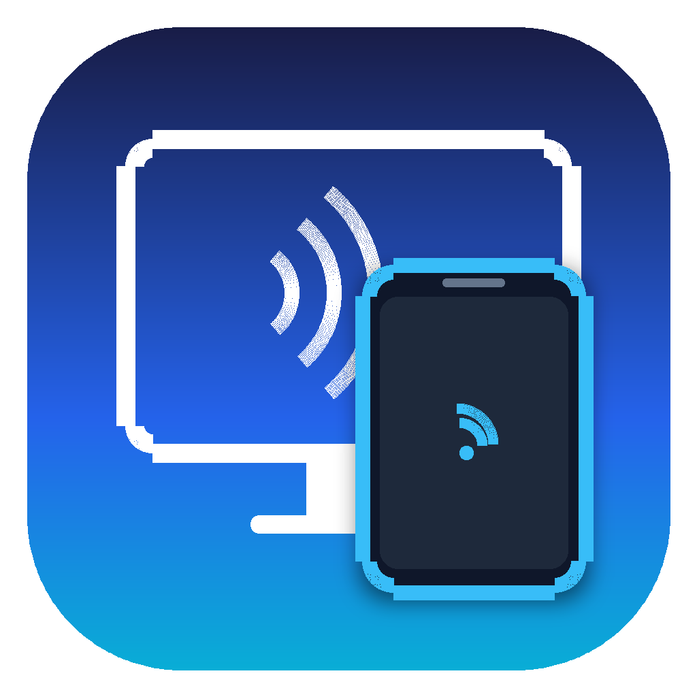

# 跨平台多协议投屏与反向控制系统 (ACast)

  

一套集成了 **“DLNA / Cast / AirPlay 免装客户端大屏投屏”** 与 **“Windows/macOS 桌面端 USB/Wi-Fi 极低延迟反向操控（全架构原生支持）”** 的开源投屏系统。

## 核心架构与多芯片支持
- 💻 **桌面端多架构原生支持（Windows & macOS 控制端）**：
  - **Windows x86_64**：传统 Intel / AMD 64位电脑。
  - **Windows ARM64**：高通骁龙 X Elite 笔记本、Surface Pro ARM 系列、Win11 on ARM，免指令模拟原生最高性能。
  - **macOS Universal 2**：一份包原生支持 Apple Silicon（M1/M2/M3/M4）与 Intel 架构 Mac。
- 📺 **场景一：大屏免装软件投屏（DLNA / Cast / AirPlay 协议体系）**：
  - 原生支持标准 DLNA、Cast 与 AirPlay 协议，局域网内任意智能电视、大屏盒子即搜即投。
  - 电视端**无需安装任何接收软件**，即搜即投，免密秒连。
- 🎮 **场景二：桌面端极低延迟 & 鼠标键盘反向操控手机（自研 FastMirror 协议）**：
  - 支持 **USB 数据线直连**（15~35ms 极低延迟）与 **局域网 Wi-Fi** 无线直连。
  - **反向操控手机**：在电脑上用鼠标点击、滑动、拖拽、滚轮，键盘按键打字，完整反向操控手机。
  - **Android (Android 7+) 控制**：基于 USB / 无线 ADB 原生隧道直接注入触控与按键，免 Root，零延迟；支持无障碍服务。
  - **iOS (iOS 16+) 控制**：采用行业标准蓝牙 HID 模拟结合 iPhone“辅助触控（AssistiveTouch）”，免越狱实现鼠标操控。
- ⚡ **全平台直接在线热更新 (In-App Auto-Update)**：
  - **macOS**：后台自动静默挂载 DMG，原子覆盖 `/Applications/ACast.app` 并自启，彻底免除手动下载拖拽 DMG。
  - **Windows**：自动静默拉取 ZIP 解压，守护进程突破文件句柄锁热替换 `.exe`，免除手动解压覆盖。
  - **Android**：应用内一键下载更新，通过 `FileProvider` 调起原生包安装器直接升级。
- 🚀 **100% 纯云端 GitHub Actions 矩阵编译**：
  - 云端自动打包输出：`Android APK`、`iOS App`、`Windows x64 (.zip)`、`Windows ARM64 (.zip)`、`macOS Universal (.dmg)` 5 大产物。

## 各平台最新安装包下载

点击下方直接下载链接可直接获取最新正式版安装包（自动定向至 GitHub Releases 最新版本）：

| 平台 / 芯片架构 | 安装包文件 | 下载链接 (最新) | 说明 |
| :--- | :--- | :--- | :--- |
| **macOS (Universal 2)** Apple Silicon (M1~M4) + Intel | `acast-macos-universal.dmg` | [⬇️ 立即下载](https://github.com/cat-clever/ACast/releases/latest/download/acast-macos-universal.dmg) | 拖拽直接安装，含 `/Applications` 替身与软件图标 |
| **Windows x86_64** 传统 Intel / AMD 64位电脑 | `acast-windows-x64.zip` | [⬇️ 立即下载](https://github.com/cat-clever/ACast/releases/latest/download/acast-windows-x64.zip) | 解压即用，原生内嵌图标，支持 USB 反控手机 |
| **Windows ARM64** 骁龙 X Elite / Surface ARM / Win11 on ARM | `acast-windows-arm64.zip` | [⬇️ 立即下载](https://github.com/cat-clever/ACast/releases/latest/download/acast-windows-arm64.zip) | 原生 ARM64 指令集，无模拟损耗 |
| **Android 手机端** Android 7.0 及以上所有机型 | `acast-android.apk` | [⬇️ 立即下载](https://github.com/cat-clever/ACast/releases/latest/download/acast-android.apk) | 支持 DLNA / Cast / AirPlay 投屏 & USB/Wi-Fi 被控 |
| **iOS 手机端** iPhone (iOS 16.0 及以上) | `acast-ios.zip` | [⬇️ 立即下载](https://github.com/cat-clever/ACast/releases/latest/download/acast-ios.zip) | 包含 ReplayKit 2 广播上传扩展与应用图标 |

> 💡 提示：如需查看版本更新日志或下载历史版本，请访问 [GitHub Releases 页面](https://github.com/cat-clever/ACast/releases)。

## 开源协议

本项目采用 **[GNU General Public License v3.0 (GPLv3)](LICENSE)** 开源许可证。

详细系统架构与协议实现请参阅：[项目开发说明文档](docs/PROJECT_SPEC.md)
